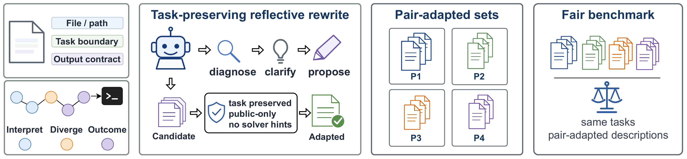

<div align="center">

# AgentMeter

### Matching Matters: A Fair Quality–Efficiency Benchmark for Command-Line Agents

**Han Chi<sup>1*</sup>, Jiaxin Qi<sup>1*</sup>, Yan Cui<sup>2</sup>, Baisheng Lai<sup>1</sup>, Jianqiang Huang<sup>1,2</sup>**

<sup>1</sup> Computer Network Information Center, Chinese Academy of Sciences  
<sup>2</sup> Hangzhou Institute for Advanced Study, Chinese Academy of Sciences  
<sup>*</sup> Equal contribution

[](pyproject.toml)
[](LICENSE)

[Research](#research) · [Results](#results) · [Reproduce](#reproduce) · [Example](#a-description-adaptation) · [Code](#code-map) · [Citation](#citation)

</div>

## Research

**Which model–harness pair solves tasks well at a reasonable cost—and how
much does its measured performance depend on the task description?**

A command-line harness determines tool interfaces, context management and
failure recovery. Changing the harness can change the same model's execution
trajectory. The wording of a task can also favor some pairs over others.
AgentMeter makes both choices explicit in quality–efficiency evaluation.

| Contribution | What it makes measurable |
|:--|:--|
| **Evaluate the pair** | An 80-task benchmark and a balanced 30-task Core Subset for comparing **7 models × 4 harnesses**. |
| **AgentMeter Score (AMS)** | Graded task quality, quality within calibrated cost budgets, and expensive zero-reward execution. |
| **AgentMeter-Opt** | Trajectory-guided description construction followed by evaluation on the **same source-balanced description set** for every target. |

<p align="center">
  
</p>

For each task and source pair, AgentMeter-Opt uses the Original trajectory
to propose clarifications. Candidates are screened for task preservation and
selected on the source pair by **reward first, cost second**. Selected
descriptions are frozen before transfer; task environments and verifiers
remain fixed.

<details>
<summary><strong>How AMS combines quality and cost</strong></summary>

AMS averages equally over fixed observed-effort strata:

$$
\mathrm{AMS}=\frac{1}{3}\sum_{s\in\{\mathrm{Easy,Medium,Hard}\}}
\left[0.6\,\mathrm{TQ}_s+0.4\,\mathrm{AUBQC}_s\right]
\left[1-\mathrm{EFR}_s\right].
$$

TQ preserves partial reward. AUBQC measures reward achieved within calibrated
billable-cost budgets. EFR discounts costly zero-reward runs. All pairs use
the same frozen strata, calibration and billing rules.

[Scoring implementation](src/agentmeter/metrics/paper.py) ·
[Protocol and aggregation](docs/paper_alignment.md)

</details>

## Results

### The harness changes the quality–efficiency trade-off

Selected Core30 configurations illustrate why completion, cost and AMS
identify different leading pairs.

| Model × harness | Full passes ↑ | Tokens / pass ↓ | USD / pass ↓ | AMS ↑ |
|:--|--:|--:|--:|--:|
| Qwen3.6-Plus × Kimi Code CLI | 16/30 | 1.71M | $0.198 | **0.525** |
| Qwen3.6-Plus × Codex CLI | 12/30 | **0.48M** | **$0.074** | 0.393 |
| Qwen3.6-Plus × Claude Code | 11/30 | 3.51M | $0.332 | 0.325 |
| GLM-5.1 × Qwen Code | **18/30** | 1.56M | $0.633 | 0.437 |
| Gemini 3.5 Flash × Codex CLI | **18/30** | 3.15M | $2.013 | 0.273 |

With Qwen3.6-Plus fixed, the harness produces a **0.200 AMS gap**. Core30
also preserves Full80 configuration trends on the shared configurations
(Spearman **ρ = 0.835**).

Tokens/pass and USD/pass include the consumption of failed runs in the
numerator. [All 28 pairs](artifacts/core30_paper_results.csv) ·
[Run-level inputs](artifacts/scoring/)

### A shared description set changes the comparison

The 16-task description study evaluates four source/target pairs under
Original, Self, Cross-only and equal-weight Pooled conditions.

| Target pair | Original AMS | Self AMS | Cross-only AMS | Pooled AMS |
|:--|--:|--:|--:|--:|
| Qwen3.6-Plus × Kimi | 0.353 | 0.509 | 0.457 | 0.470 |
| Qwen3.6-Plus × Codex | 0.250 | 0.600 | 0.411 | 0.457 |
| DeepSeek-V4-Pro × Kimi | 0.341 | 0.517 | 0.438 | 0.457 |
| GLM-5.1 × Qwen | 0.389 | 0.498 | 0.429 | 0.446 |
| **Macro** | **0.333** | **0.531** | **0.434** | **0.458** |

**Pooled increases macro AMS from 0.333 to 0.458 (+0.125)** and changes the
leading target from GLM × Qwen to Qwen × Kimi. Self measures adaptation to
the description source; Cross-only measures transfer from the other three
sources. Pooled evaluates every target on all four sources with equal weights,
so it does not select a different best description for each target.

[Condition definitions](docs/paper_alignment.md#conditions-and-counts) ·
[Archived observations and accounting](artifacts/scoring/README.md)

## Reproduce

The release includes **1,160 run records**, frozen task lists and calibration,
**16 executable tasks**, and **16 selected description pairs** from the
64-description study. Core30/Full80 execution uses a separate task checkout.
[Reproduction scope](docs/reproduction_status.md)

### 1. Install and recompute the paper tables

Python 3.11+ is sufficient for scoring. Use Python 3.12 or 3.13 if you also
plan to run Harbor and AgentMeter-Opt.

```bash
git clone https://github.com/bothan66/AgentMeter.git
cd AgentMeter
python -m venv .venv
source .venv/bin/activate
python -m pip install -e .

agentmeter tables
agentmeter tables --descriptive
```

This recomputes all 28 Core30 rows and the description-condition results
from the archived observations. No API or Docker is needed. Use
`agentmeter tables --examples` for the 16 released Original/Self pairs.

### 2. Run an Original/optimized comparison

The example uses the paper's **Qwen3.6-Plus × Codex CLI** pair on `regex-log`.
Live execution requires Docker, provider credentials, and network access for
images and dependencies. Provider calls incur charges.

<details>
<summary><strong>Prepare Harbor and configure the provider</strong></summary>

```bash
agentmeter setup

export AGENTMETER_MODEL='Qwen3.6+'
export AGENTMETER_AGENT=codex
export AGENTMETER_AGENT_VERSION=0.153.0
export OPENAI_API_KEY=your-provider-key
export OPENAI_BASE_URL=https://provider.example/v1
export CODEX_FORCE_API_KEY=1
export CODEX_WIRE_API=responses
```

Use your provider's model identifier and a Responses endpoint reachable
from the task container. The setup command installs pinned Harbor and
AgentMeter's adapters; the example tasks are already included. Codex 0.153.0
pins the released execution recipe, not every historical paper run.

[Execution and data-disk setup](docs/external_dependencies.md) ·
[Optional CLIProxyAPI routing](integrations/cliproxyapi/)

</details>

```bash
agentmeter probe
agentmeter compare qwen36_codex original regex-log --dry-run
agentmeter compare qwen36_codex original regex-log
agentmeter compare qwen36_codex optimized regex-log
```

The positional pair selects the **description source**; the configured model
and agent select the **evaluation target**. Matching them gives Self.
Each invocation keeps its instruction snapshot, `result.json`,
`agent/trajectory.json` and verifier output under a separate `jobs/` directory.
Omitting task IDs runs the same released source-specific subset in both conditions.

### 3. Extend the study

| Goal | Entry point |
|:--|:--|
| Run a frozen Core30 or Full80 selection | [`agentmeter suite`](docs/reproduction_status.md#run-core30-or-full80) |
| Construct a rewrite from an Original trajectory | [`agentmeter optimize`](docs/optimization.md) |
| Compute AMS from task-level reward and USD cost | [`agentmeter score --runs condition.csv`](docs/paper_alignment.md) |

All commands also work as `python -m agentmeter`. The
[reproduction guide](docs/reproduction_status.md) covers installed wheels,
external task directories and validation.

## A description adaptation

**`regex-log` · Qwen3.6-Plus × Codex CLI**

> **Original:** Save your regex in `/app/regex.txt`.
>
> **Rewrite:** Save your regex in `/app/regex.txt`. The file must contain only
> the raw regex string, with no extra text, markdown, or explanations.

The Original's public Python example reads the file directly as a pattern.
The rewrite makes that output-file contract explicit.

| Archived condition | Reward | Cost (USD) | Billable-component tokens |
|:--|--:|--:|--:|
| Original | 1.0 | 0.02238 | 67,380 |
| Self rewrite | 1.0 | 0.01726 | 59,868 |

This historical pair preserves reward while reducing recorded cost by **22.9%**.
The 16 selected examples cover 13 tasks and all four source configurations;
each retains the original benchmark instruction and the evaluated rewrite.

[Read this pair](artifacts/agentmeter_opt_final16/descriptions/qwen36_codex/regex-log/) ·
[Browse all 16 pairs and results](artifacts/agentmeter_opt_final16/README.md) ·
[Interpretation and public evidence](docs/description_notes.md)

## Code map

The research implementation lives in one installable Python package:

| Module | Responsibility |
|:--|:--|
| [`agentmeter.metrics`](src/agentmeter/metrics/) | Manuscript AMS and calibration inputs |
| [`agentmeter.optimization`](src/agentmeter/optimization/) | Trajectory evidence, candidate construction and preservation checks |
| [`agentmeter.runtime`](src/agentmeter/runtime/) | Pinned Harbor setup, task selection and paired execution |
| [`agentmeter.reporting`](src/agentmeter/reporting/) | Archived result validation and table reproduction |
| [`agentmeter.providers`](src/agentmeter/providers/) | Endpoint probes and private routing configuration |

[Architecture](docs/architecture.md) · [Task lists](configs/task_lists/) ·
[Bundled tasks](benchmark_tasks/) · [Scoring data](artifacts/scoring/)

Harbor patches and the separately attributed CLIProxyAPI Go snapshot live
in `integrations/`. Credentials, runtime caches and new trajectories are
excluded from Git.

## Citation

```bibtex
@article{chi2026matching,
  title   = {Matching Matters: A Fair Quality--Efficiency Benchmark for Command-Line Agents},
  author  = {Chi, Han and Qi, Jiaxin and Cui, Yan and Lai, Baisheng and Huang, Jianqiang},
  year    = {2026}
}
```

## License

AgentMeter code: [MIT](LICENSE). Harbor compatibility patches:
[Apache-2.0](integrations/harbor/LICENSE). Benchmark tasks, data and retained
instruction content follow their upstream terms; see
[third-party notices](THIRD_PARTY_NOTICES.md) and
[example provenance](artifacts/agentmeter_opt_final16/README.md#provenance-and-reuse).
